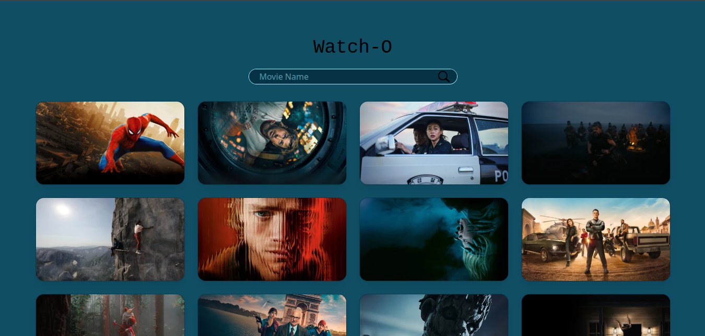

# Watch-O
Watch-O is a movie searching and discovering site made possible by TMDB.

Live project link : [Watch-O](https://watch-o.vercel.app)

## Features avaiable
- Searching for movies
- Discovering trending movies at the time of opening the site
- Short, spoiler-free description on the movies you view

# Running it locally 
To run it locally the main thing you need is a TMDB API key. Since you can't really get mine after clonning this repo. You also need node.js v24 installed.

Commands you should run:

git clone https://github.com/natiked/Watch-O
cd Watch-O
npm install

Then you'll need to create a .env file inside the Watch-O folder and write this in that file:
VITE_API_KEY='your api key'

Then run the project using the below command :
npm run dev

